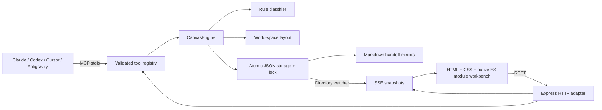

# Infinite Canvas MCP — Stage 3

A local infinite canvas workbench for stage-based project learning, validated
cross-project experience, and seamless AI handoff. The implementation follows
[ARCHITECTURE.md](ARCHITECTURE.md): Stage 1 supplies the TypeScript domain engine,
Stage 2 supplies MCP stdio and REST/SSE, and Stage 3 supplies the interactive Chinese
Web UI and real-browser end-to-end acceptance tests. No external database or LLM
service is required.

## Run

Requires Node.js 22 or newer and npm.

```sh
npm install
npm run test:install
npm test
npm run typecheck
npm run build
npm start
```

`npm start` starts the HTTP server at `http://127.0.0.1:3456`.
Set `PORT` to change the port, `HOST` to change the bind address, and `DATA_DIR`
to select a shared data directory (default: `data` under the working directory).
On first boot it creates `data/store.json` and one
`data/handoffs/HANDOFF-<canvasId>.md` per canvas. The illustrative demo contains two
groups, an active project with stages 1 and 2 consolidated and stage 3 in progress,
and a completed project with final practices and reusable experiences. Demo history
illustrates the domain model, with populated category clusters and provenance links.
An existing store, including an empty store, is never reseeded. Runtime data is ignored
by Git; fixture generation lives in `createDemoStore()`.

Open **http://127.0.0.1:3456** after `npm start`. To run the compiled HTTP entrypoint,
use `node dist/src/index.js` after building; keep `src/web` alongside `dist`.
For this Windows checkout:

```powershell
Set-Location 'E:\idm\无限画布'
$env:DATA_DIR = 'E:\idm\无限画布\data'
npm start
```

The server binds to loopback by default and is intended as a local workbench.
Its API has no authentication; configure access controls before exposing it remotely.

## Workbench workflow

1. **画布分组**: use `＋` to create a named, colored group. Select a group to filter
   the canvas list, or select **全部画布**. Filtering does not change the active project.
2. **画布列表**: create a canvas with a globally unique project key and a group.
   Select a canvas to switch the persisted active project. Each entry shows its
   current stage and **进行中 / 已结项 / 已归档** status.
3. **＋ 记录学习/功能/约定**: enter title, content, optional category, tags, files,
   importance, and record status. Leave category on **自动分类** for deterministic
   Chinese/English classification. Only check **已经过实践验证** when verified.
   The resulting card is placed in its stage's matching category cluster.
4. **阶段分类整理**: generate category summaries and archive the current stage.
   Optionally select automatic advancement and name the next stage. Otherwise use
   **开启下一阶段** before recording more knowledge; it also consolidates the previous
   stage if needed. History and evidence links remain available.
5. **项目结尾总整理**: review unvalidated active records, optionally confirm specific
   records as verified, and supply a handoff summary. This completes the project and
   makes its canvas read-only. Eligible findings appear in the gold/cyan **终局精华区**
   with conventions, best practices, core implementations, architecture, and reusable
   patterns. Unvalidated/open/superseded evidence is preserved but not published.
6. **跨项目经验库**: search titles/content/tags and filter by category. Create or select
   an active successor canvas, then click **应用到当前画布** on a practice from another
   project. The import retains provenance and requires validation in its new context.
7. **跨 AI 无缝交接**: inspect conventions, stage history, final practices, next steps,
   and the complete live `HANDOFF.md`. Copy it into a new AI session, or connect that
   AI using the drawer's MCP configuration and call `get_handoff_context` first.

The five clusters are **规定做法与约定**, **架构与模型设计**, **功能实现**,
**踩坑与问题修复**, and **最终确定的好用法**. All cards use engine-provided world
coordinates. Click a card for full content, tags, files, validation, and provenance.
Stage summaries and long card text can be inspected in the drawer without losing
the canvas view. SVG arrows connect evidence, checkpoints, and final distilled cards.

Drag an empty part of the canvas to pan; use the wheel to zoom around the cursor.
The footer provides zoom buttons and **适应全图**. Stage pills jump to any stage or
the final zone. Focus the viewport for arrow-key panning, `+`/`-` zoom, and `F` to fit.
Tab navigation brings offscreen cards into view; dialogs support Escape and focus
containment. View positions persist per canvas in browser local storage. They are
personal navigation state and do not change the shared domain layout.

The **MCP 实时同步已连接** badge reports the browser's SSE connection, not whether a
particular AI client is running. Successful REST and MCP writes update the canvas,
experience pool, and open handoff drawer automatically. A disconnected browser
shows a reconnecting state and receives the latest snapshot on reconnect. Forms
retain their explicit target canvas if another client switches the active canvas.
Server errors are displayed without discarding entered form values.

## Architecture overview



`src/types/schema.ts` validates the domain. `src/core` owns classification, geometry,
stage transitions, validation gates, experience provenance, and persistence.
`src/mcp` exposes nine tools and three resources; `src/server/app.ts` serves REST,
SSE, and static assets. `src/web/index.html`, `styles.css`, and `app.js` implement
the UI without a frontend framework or CDN dependency. DOM cards and SVG edges share
one translated/scaled world container. The UI escapes project content and treats
Markdown as text. Full snapshots are reconciled without resetting the viewport;
stale asynchronous handoff/search responses are ignored. The current renderer
renders every card; very large stores may eventually benefit from viewport culling.

## MCP stdio and resources

Run `npm run mcp` to launch the stdio server. When connecting an MCP host, use
`node --import tsx <absolute-path>/src/mcp/server.ts` from this repository's working
directory, or `npm run --silent mcp` so npm's banner does not enter the protocol stream.
Server diagnostics go to stderr; stdout is reserved for MCP JSON-RPC frames.
The implementation uses the installed v1 SDK's `Server` and `StdioServerTransport`;
see the [official SDK transport documentation](https://ts.sdk.modelcontextprotocol.io/server).

### Claude Code / Cursor / Antigravity

Run `npm run build` first, then use this JSON for the compiled stdio server:

```json
{
  "mcpServers": {
    "infinite-canvas": {
      "command": "node",
      "args": ["E:/idm/无限画布/dist/src/mcp/server.js"],
      "env": { "DATA_DIR": "E:/idm/无限画布/data" }
    }
  }
}
```

Place this in the project's `.mcp.json` for
[Claude Code](https://code.claude.com/docs/en/mcp), or `.cursor/mcp.json` for
[Cursor](https://cursor.com/docs/mcp). In
[Antigravity](https://antigravity.google/docs/ide-mcp), open **MCP Servers → Manage
MCP Servers → View raw config** and merge the entry into the custom configuration.
Keep other existing server entries. Restart/refresh the client's MCP connection.

### Codex

[Codex uses TOML](https://developers.openai.com/codex/mcp), rather than the JSON
wrapper above. Add this to `~/.codex/config.toml` (or the trusted project's
`.codex/config.toml`):

```toml
[mcp_servers.infinite-canvas]
command = "node"
args = ["E:/idm/无限画布/dist/src/mcp/server.js"]

[mcp_servers.infinite-canvas.env]
DATA_DIR = "E:/idm/无限画布/data"
```

The drawer offers both ready-to-copy JSON and Codex TOML, generated from the running
server's **absolute Node executable, checkout path, and actual data directory** via
`GET /api/mcp/config`. This also works when the host does not support `cwd`. If using
the manual examples, ensure `node` is available on the client's PATH. Use forward
slashes in hand-written Windows configuration, or escape backslashes correctly.

Set the HTTP process's `DATA_DIR` to that same directory. Each operation reloads
the shared store; changing the active canvas affects subsequent calls from every client.
Pass an explicit `canvasId` when multiple agents work on different projects.

All nine architecture tools are registered. `manage_canvas_group` takes
`action: "create" | "list" | "update"`; creation requires `name`, and updates require
`groupId`. `create_or_switch_canvas` takes `action: "create" | "switch"`; creation
requires `groupId`, `title`, and `projectKey`, while switching requires `canvasId`.
The other tools accept the corresponding core operation's fields plus optional
`canvasId`. `advance_project_stage` accepts `title`; search accepts `query`, `category`,
`tags`, `excludeCanvasId`, and `limit`. Discover complete schemas via MCP `tools/list`
or `GET /api/mcp/tools`.

The shared programmatic interface is transport independent:

```ts
import { invokeTool, listTools, readResource } from './src/mcp/tools.js';

const handoff = invokeTool(engine, 'get_handoff_context', {});
const catalog = listTools();
const markdown = readResource(engine, 'canvas://active/handoff.md');
```

`invokeTool` validates input and returns the raw domain result, or throws a
`ToolInvocationError` with `code` and HTTP `status`. MCP calls return that result
as JSON text and as `structuredContent: { result }`. Tool validation and business
failures return MCP `isError: true`; unknown tool/resource names are protocol errors.
Read-only resources are generated from the current store on every request:

| Resource URI | Content |
| --- | --- |
| `canvas://active/handoff.md` | Active project's complete Markdown handoff |
| `canvas://active/handoff.json` | Structured handoff, including its Markdown |
| `canvas://global/experiences` | Entire validated experience catalog, without pagination |

Handoff resources report a missing canvas until one is created. The global catalog
works with an empty store. Resources are read on demand; browser updates use SSE.

## REST and live browser updates

All request bodies are JSON. Responses contain the raw domain result, except the
MCP endpoints shown below. Successful creation/recording/import endpoints return
201; other successful endpoints return 200. Errors use
`{ "error": { "code": "...", "message": "..." } }`: 400 for invalid input/JSON,
404 for missing entities/tools, 409 for conflicting state, 413 for bodies over 1 MB,
503 for a busy store lock, and 500 for internal or handoff mirror failures.

| Method and path | Operation |
| --- | --- |
| `GET /api/state` | Full current store snapshot |
| `GET /api/groups` | List groups |
| `POST /api/groups` | Create group: `name`, optional `description`, `color`, `icon` |
| `PATCH /api/groups/:groupId` | Update only supplied group fields |
| `GET /api/canvases?groupId=...` | List canvases, optionally filtered |
| `GET /api/canvases/:canvasId` | Read canvas; `active` selects the current canvas |
| `POST /api/canvases` | Create and activate canvas |
| `POST /api/canvases/:canvasId/switch` | Switch active canvas |
| `POST /api/learnings` | Record learning, with automatic classification by default |
| `POST /api/stages/consolidate` | Checkpoint; optional `advanceToNextStage`, `nextStageTitle` |
| `POST /api/stages/advance` | Advance; optional `title` |
| `POST /api/distill` | Finalize; optional `validatedNodeIds`, `summary` |
| `GET /api/handoff?canvasId=...&format=json` | Handoff JSON; use `format=markdown` for Markdown |
| `GET /api/handoff.md?canvasId=...` | Markdown handoff |
| `GET /api/experiences` | Search using `query`, `category`, `tags`, `excludeCanvasId`, `limit` |
| `POST /api/experiences/apply` | Import `experienceId` into optional `canvasId` |
| `GET /api/mcp/tools` | `{ tools: [...] }`, including JSON input schemas |
| `GET /api/mcp/config` | `{ json, codexToml }` using this checkout, Node executable, and data directory |
| `POST /api/mcp/call` | `{ name, arguments?: {...} }` → `{ result: ... }` |
| `GET /api/events` | SSE stream of complete store snapshots |

Learning, consolidation, advancement, distillation, import, and handoff routes also
exist below `/api/canvases/:canvasId/` with the same suffix, for example
`POST /api/canvases/:canvasId/stages/consolidate` and
`GET /api/canvases/:canvasId/handoff.md`. Mutation bodies can instead include
`canvasId` on the shorter routes. Search tags may be comma-separated or repeated
(`?tags=storage&tags=atomic`).

Each SSE connection immediately receives `event: canvas-update` with the full store
as JSON `data`. HTTP writes publish immediately; an `fs.watch` on the data directory
detects external `store.json` replacements, including writes from separate MCP
processes, and coalesces them over 20 ms. Watching the directory keeps updates
working across successive atomic renames. Identical snapshots are suppressed;
invalid external snapshots are logged and never broadcast. Updates resume after
the store is repaired. Heartbeats run every 15 seconds. Reconnection always sends
the latest full snapshot; event IDs are local to the server run, not a replay log.
SSE carries application state, not an MCP HTTP transport.

```js
const events = new EventSource('/api/events');
events.addEventListener('canvas-update', event => {
  const store = JSON.parse(event.data);
  // Reconcile navigation, world geometry, experience pool, and open handoff drawer.
});
```

Static assets are served from `src/web` (also when running compiled server code).
`/` serves the workbench, and `/app.js` and `/styles.css` serve its native assets.
For embedding/tests, `createApp({ engine, webDir? })` returns `{ app, engine, close }`;
call `close()` to dispose its watcher and SSE clients. `startHttpServer({ port: 0 })`
returns the HTTP `server` and an idempotent async `stop()` for complete shutdown.

## Core API

Import `CanvasEngine` from `src/core/engine.ts` (use `.js` imports in NodeNext
TypeScript source). All methods are synchronous and return detached snapshots.
Omitting `canvasId` selects the persisted active canvas.

```ts
import { CanvasEngine } from './src/core/engine.js';

const engine = new CanvasEngine({ dataDir: './my-project-data', seedDemo: false });
const group = engine.createGroup({ name: 'Engineering' });
const canvas = engine.createCanvas({
  groupId: group.id,
  title: 'Release service',
  projectKey: 'release-service',
  description: 'Reliable release orchestration',
});

engine.recordLearning({
  title: 'Agreed service boundary convention',
  content: 'Validate every request before invoking domain logic.',
  tags: ['validation'],
  relatedFiles: ['src/contracts.ts'],
  importance: 5,
  validated: true,
});
engine.consolidateStage(canvas.id, {
  advanceToNextStage: true,
  nextStageTitle: 'Recovery validation',
});
const pending = engine.recordLearning({
  title: 'Recovery drill',
  content: 'Verify recovery after an interrupted state write.',
  category: 'best_practice',
  status: 'open',
});
// After the project actually validates this finding:
engine.updateLearning(pending.id, { status: 'active', validated: true });
engine.finalizeProjectDistillation(canvas.id);
const handoff = engine.getHandoffContext(canvas.id); // structured JSON + .markdown

const successor = engine.createCanvas({ groupId: group.id, title: 'Next service', projectKey: 'next-service' });
const experiences = engine.queryCrossProjectExperiences({ query: 'validation', tags: ['validation'] });
if (experiences[0]) engine.applyExperienceToCanvas(experiences[0].id, successor.id);
```

| Operation | Signature |
| --- | --- |
| Groups | `createGroup(input)`, `listGroups()`, `updateGroup(groupId, patch)` |
| Canvases | `createCanvas(input)`, `listCanvases(groupId?)`, `getCanvas(canvasId?)`, `switchCanvas(canvasId)` |
| Learning | `recordLearning(input, canvasId?)`, `updateLearning(nodeId, review, canvasId?)` |
| Checkpoint | `consolidateStage(canvasId?, { advanceToNextStage?, nextStageTitle? })` |
| Advance | `advanceStage(canvasId?, title?)` |
| Finalize | `finalizeProjectDistillation(canvasId?, { validatedNodeIds?, summary? })` |
| Handoff | `getHandoffContext(canvasId?)` |
| Search | `queryCrossProjectExperiences({ query?, category?, tags?, excludeCanvasId?, limit? })` |
| Import | `applyExperienceToCanvas(experienceId, canvasId?)` |

Input and domain types plus Zod schemas are exported from `src/types/schema.ts`.
`importance` is an integer from 1 to 5 (default 3). Node statuses are `active`,
`open`, and `superseded`; validation is a separate boolean, defaulting to false.

## Domain behavior

- Classification uses deterministic English/Chinese title, content, and tag rules.
  Explicit categories take precedence. Summary bullets are extracted from the
  original text; reusable candidates are suggestions, not validation evidence.
  Ambiguous language can require an explicit category; this engine does not call an LLM.
- Stage X positions are `(stageNumber - 1) * 1500`. Five ordered vertical containers
  grow downward to fit three-column card grids. All geometry is in `bounds` and uses
  absolute world coordinates. Final cards have their own zone to the right and keep
  source references to the original cards.
- Duplicate learning with the same normalized title/content/category/status in a
  stage merges tags, files, validation, and importance. Consolidation creates one
  summary per populated category, preserving original records and evidence edges.
  Repeating a checkpoint without advancement is idempotent. Checkpoints are historical
  snapshots; later review updates the original evidence and future distillation.
- Explicit advancement first consolidates the current stage. A consolidated stage
  rejects additional learning until advancement. New canvases become active;
  switching canvases is persisted. Project keys are unique across groups.
- Finalization publishes active, explicitly validated conventions and best practices,
  plus validated architecture, implementations, and fixes with importance 4 or 5.
  Open, superseded, and unvalidated records remain visible in the handoff but are
  excluded from reusable experience. `validatedNodeIds` explicitly confirms selected
  active originals before finalization. Fixes become validated best-practice guidance.
  Equivalent findings across stages share an experience with all source IDs retained.
  Repeated finalization is idempotent; completed canvases reject further edits.
- Imported implementation/architecture experience goes to the architecture cluster;
  other experience goes to conventions. Importing the same experience twice returns
  the existing card. Source-project paths remain in provenance, rather than being
  attached as target-project files. Imported guidance requires validation in its new
  context before it can be republished.
- Search combines case-insensitive keyword matching (all words), category filtering,
  and tag filtering (all tags), ranking title matches first. The default limit is 100.
- Handoffs include project background, conventions, historical category checkpoints,
  implementation/architecture indices, unresolved items, final practices, imported
  provenance, every original record, and evolution links. Generated timestamps are
  based on project/group updates so JSON and file mirrors agree.

## Persistence and recovery

Every write reloads and validates the latest store under an exclusive filesystem
lock, then writes a same-directory temporary file, flushes it, and atomically renames
it over `store.json`. Invalid mutations leave the existing snapshot unchanged.
The lock prevents conflicting writers; a competing process receives an explicit
retryable error. After a process crash, remove `data/store.lock` only after confirming
its writer is no longer running. Corrupt stores fail loudly and are never reseeded.

Markdown is derived from JSON and refreshed after each mutation. JSON and all Markdown
files cannot be committed as one filesystem transaction: a mirror-write failure reports
that JSON was committed. Fix the filesystem issue and restart the engine to regenerate
missing or stale mirrors. The synchronous, whole-store design targets local project
knowledge stores; larger deployments can replace the storage adapter in a later stage.

## Verification

Install the Chromium test browser once after `npm install` (repeat after Playwright
upgrades), then run all checks:

```sh
npm run test:install
npm test
npm run typecheck
npm run build
```

On Linux CI, install browser OS dependencies with `npx playwright install --with-deps chromium`.
`npm test` includes browser acceptance tests and does not silently skip them if
Chromium is absent. `npm run test:e2e` runs just the Stage 3 browser suite.

`tests/engine.test.ts` uses Node's built-in runner through
`node --import tsx --test`. It exercises all Stage 1 operations, bilingual classification,
geometry containment and overlap, provenance, validation gates, idempotency, persistence
across engine instances, corrupt-store protection, and handoff recovery. Tests use isolated
temporary directories and do not modify the working demo store.

`tests/mcp_and_server.test.ts` exercises all nine tools through direct invocation and
an SDK client/server protocol connection, resource discovery/reads, all REST routes,
static files, validation and conflict errors, and a real stdio child process writing
to the shared store while multiple SSE clients observe consecutive atomic updates.
It also checks reconnect snapshots, shutdown, busy-store responses, and recovery
after an invalid external store. HTTP tests use ephemeral ports and isolated data.

`tests/web_e2e.test.ts` drives real Chromium against the production static assets and
an isolated server. It covers the complete two-stage record → auto-classify →
consolidate → final distillation → successor-project reuse → handoff workflow,
real stdio MCP writes reflected in the DOM, REST/MCP facade writes, clipboard copy,
live handoff updates, reconnect recovery, JSON/TOML configuration, world coordinates,
edges, pan, cursor-anchored zoom, fit, stage jumps, filtering, keyboard navigation,
responsive viewports, safe text rendering, form errors, and canvas-target isolation.
It uses fresh temporary stores and never changes the working demo data.
